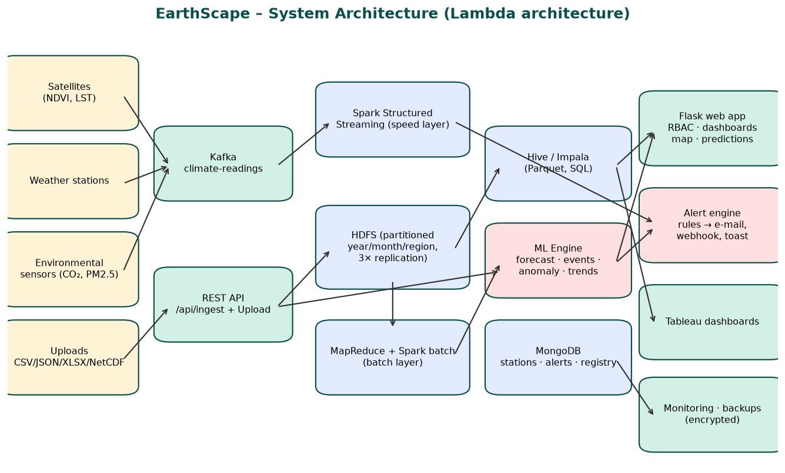
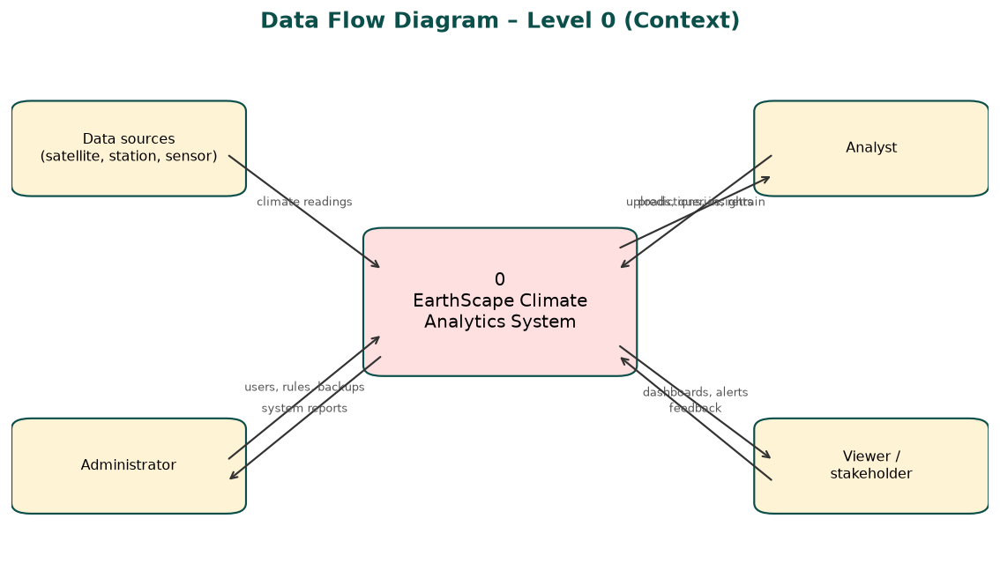
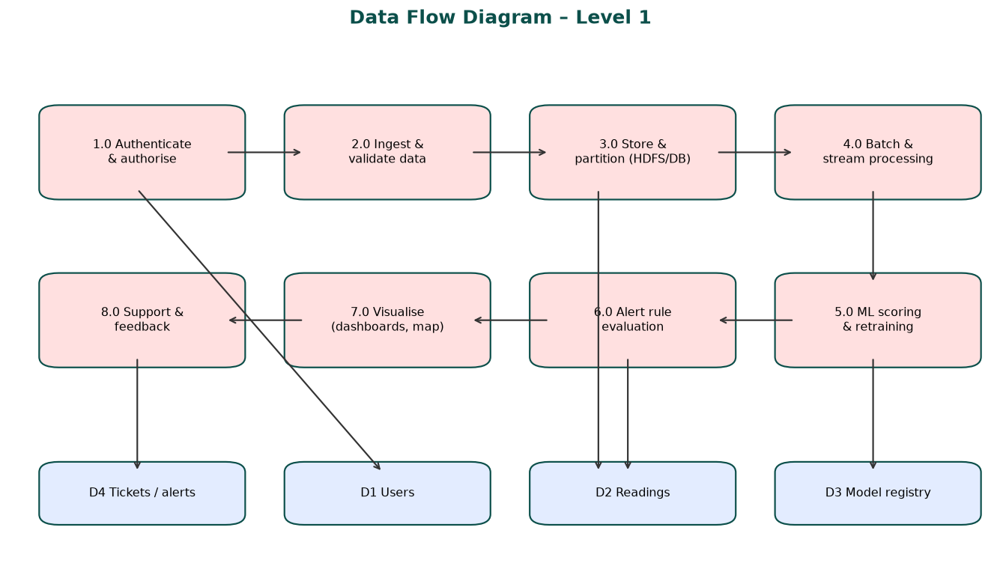
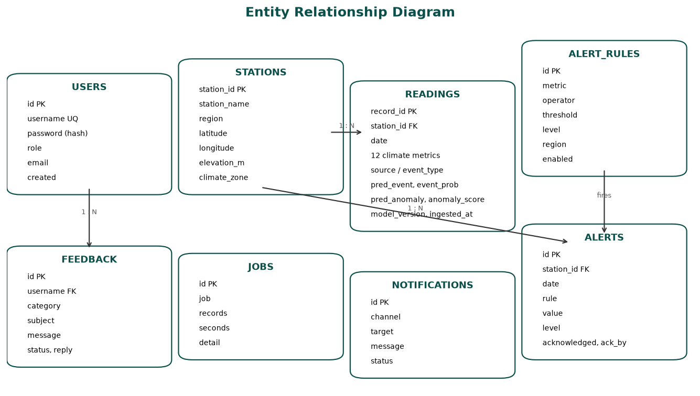
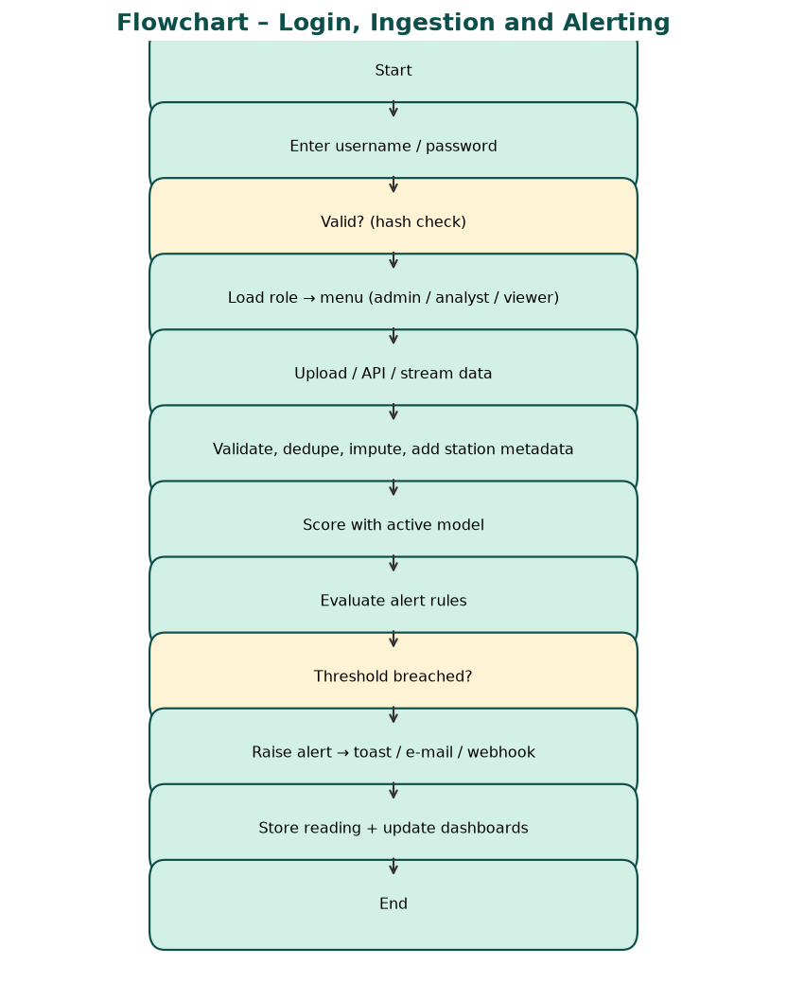
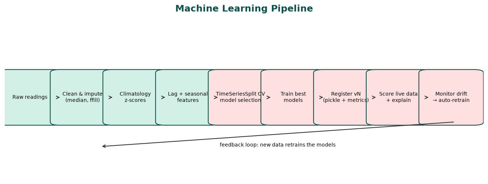
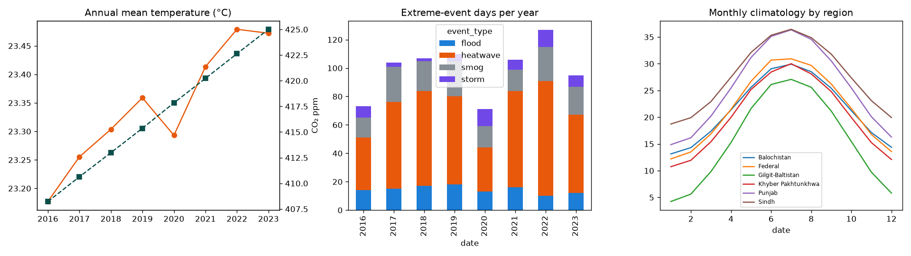

# 1. Introduction

EarthScape Climate Agency monitors climate change using data from satellites, weather stations and environmental sensors. The volume, variety and velocity of this data exceed what spreadsheets or a single database can handle. This project delivers a complete big-data and machine-learning platform that ingests historical and real-time climate data, stores it in a scalable and fault-tolerant way (HDFS), processes it in parallel (MapReduce, Spark), applies machine-learning models for prediction, anomaly detection and trend analysis, and presents the results in interactive dashboards with automated alerts.

# 2. Problem Statement

The agency needs to:

- collect heterogeneous climate datasets (satellite imagery products, station records, sensor streams) in several formats;
- store years of data reliably and query it quickly;
- identify climate patterns, anomalies and correlations, including when records are incomplete;
- forecast climate variables and detect extreme events early;
- notify stakeholders automatically when thresholds are crossed;
- give different users (administrators, analysts, stakeholders) secure, role-appropriate access.

# 3. Objectives

1.  Build a secure, role-based web application for climate monitoring.
2.  Ingest CSV, JSON, Excel, Parquet and NetCDF data, in batch and in real time.
3.  Store data in HDFS with year/month/region partitioning and 3× replication.
4.  Implement MapReduce and Spark jobs for parallel processing.
5.  Develop ML models for temperature forecasting, extreme-event classification, anomaly detection, trend and correlation analysis, and keep them up to date automatically.
6.  Provide interactive dashboards (web + Tableau), a station map and data exploration tools.
7.  Provide configurable, real-time alerts and a support/feedback system.
8.  Meet non-functional goals: performance monitoring, encryption, backups, scalability, documentation.

# 4. Scope and Dataset

The dataset simulates **12 stations across Pakistan’s climate zones** (Karachi, Hyderabad, Sukkur, Lahore, Multan, Faisalabad, Islamabad, Peshawar, Swat, Quetta, Gwadar, Gilgit) with daily readings.

| Item           | Sample (training)                                                                                                             | Testing                 |
|----------------|-------------------------------------------------------------------------------------------------------------------------------|-------------------------|
| Period         | 2016-01-01 → 2023-12-31                                                                                                       | 2024-01-01 → 2024-12-31 |
| Readings       | 35,064                                                                                                                        | 4,392                   |
| Metrics        | 12 (temperature, max/min, humidity, precipitation, wind, pressure, CO₂, PM2.5, NDVI, land-surface temperature, soil moisture) | same                    |
| Sources        | weather_station 60%, env_sensor 25%, satellite 15%                                                                            | same                    |
| Labels         | event_type (none, heatwave, flood, storm, smog), is_anomaly                                                                   | same                    |
| Missing values | 2–6% in humidity, wind, PM2.5, NDVI, LST, soil moisture                                                                       | same                    |

The generator (`data/generate_data.py`) models seasonality, the monsoon, a warming trend (~0.35 °C/decade), rising CO₂ (~2.4 ppm/year), regional differences, injected heatwaves, floods, storms and smog episodes, sensor faults and missing values, so all functional requirements can be demonstrated realistically.

# 5. Requirement Traceability

| Requirement                                  | Implementation                                                                                                                                              |
|----------------------------------------------|-------------------------------------------------------------------------------------------------------------------------------------------------------------|
| Authentication & authorisation               | Hashed passwords (Werkzeug PBKDF2), sessions with HttpOnly cookies, roles admin / analyst / viewer, route-level access control (403 for unauthorised pages) |
| Data ingestion – diverse formats             | Upload CSV, TXT, JSON, XLSX, Parquet, NetCDF (.nc); REST API `/api/ingest`; built-in live stream; `simulator.py`; Kafka producer                            |
| Historical & real-time                       | Historical archive loaded at start, batch uploads, real-time API/stream; Spark Structured Streaming for production                                          |
| Storage – HDFS, partitioning                 | `hadoop/01_hdfs_ingest.sh` (source/year/month/region partitions, replication 3), Hive partitioned Parquet tables; app uses indexed SQLite (station, date)   |
| MapReduce processing                         | `hadoop/mapper.py`, `reducer.py`, `04_run_mapreduce.sh` – monthly station climate summary                                                                   |
| Patterns, anomalies, correlations            | Climatology z-scores, Isolation Forest, correlation matrix (Explore page, Impala SQL, notebook, R)                                                          |
| Missing data                                 | Median imputation in pipelines, forward-fill lags, station metadata completion, Hive COALESCE/window averages, Spark imputation, MapReduce counters         |
| Real-time + batch integration                | Lambda architecture: stream joined with batch climatology; app scores live data with models trained on history                                              |
| ML – prediction, anomaly, trend, correlation | 5 models (see §8); automatic retraining and versioning                                                                                                      |
| Visualisation                                | Live dashboard, Leaflet map, Explore (custom time-series, correlation heat-map, trends), Tableau extracts and guide                                         |
| Notifications & alerts                       | Configurable rules (metric, operator, threshold, region, level); dashboard pop-ups, e-mail (SMTP) and webhook; notification log; acknowledgement            |
| Feedback & support                           | Ticket system with categories, admin replies and status                                                                                                     |
| Performance monitoring                       | Monitor page: CPU, RAM, disk, process memory, endpoint latency (avg/p95), ingestion throughput, job durations, drift                                        |
| Security                                     | Password hashing, RBAC, API key, security headers, optional HTTPS (`EARTHSCAPE_HTTPS=1`), AES-encrypted backups (Fernet)                                    |
| Reliability – backups                        | Automated backups every N hours, retention, manual backup, download, restore script                                                                         |
| Scalability                                  | HDFS/Spark horizontal scaling, stateless Flask behind load balancer (gunicorn, Docker), configurable parallel jobs                                          |
| Documentation                                | This document, developer, manual, user guides, papers, video script                                                                                         |

# 6. System Architecture

System architecture

The platform follows a **Lambda architecture**:

- **Batch layer** – HDFS stores the immutable master dataset; MapReduce and Spark batch compute climatologies, monthly summaries and trends; Hive/Impala serve SQL.
- **Speed layer** – Kafka receives live readings; Spark Structured Streaming compares them with the batch climatology and emits alerts.
- **Serving layer** – the Flask application, ML engine, MongoDB (stations, alerts, model registry) and Tableau.

# 7. Design Diagrams

## 7.1 DFD Level 0

DFD level 0

## 7.2 DFD Level 1

DFD level 1

## 7.3 Entity Relationship Diagram

ERD

## 7.4 Flowchart

Flowchart

# 8. Machine Learning

ML pipeline

| Model            | Task                                   | Algorithms compared                                             | Selected        | Result                                                                              |
|------------------|----------------------------------------|-----------------------------------------------------------------|-----------------|-------------------------------------------------------------------------------------|
| Forecast         | Next-day mean temperature per station  | Ridge, Random Forest, HistGradientBoosting, Deep MLP 64-32-16 (TimeSeriesSplit CV) | Ridge (app run) | Hold-out MAE 1.35 °C, R² 0.94 (persistence baseline 1.71 °C); 2024 test MAE 1.70 °C |
| Event classifier | none / heatwave / flood / storm / smog | Random Forest, HistGradientBoosting, Deep MLP 128-64-32         | Random Forest   | Hold-out macro-F1 0.84; 2024 test macro-F1 0.91                                     |
| Anomaly detector | Unusual readings, sensor faults        | Isolation Forest ∧ Deep Autoencoder 32-8-32, ∨ z-score \> 4    | Ensemble        | 2024 test precision 0.79, recall 0.53                                               |
| Trend analysis   | Warming per station                    | Linear regression on annual means                               | –               | +0.41 °C per decade average                                                         |
| Seasonal outlook | 12-month regional temperature          | Linear trend + seasonal harmonics                               | –               | Shown on dashboard                                                                  |

Key design choices:

- **Time-based validation** – no shuffling; future data never leaks into training.
- **Climatology features** – each reading is compared with the normal for that station and calendar month, making models location-aware.
- **Runtime training** – models are trained on the user’s machine at first start, so they always match the installed Python and scikit-learn.
- **Continuous refinement** – after 5,000 new readings (configurable) models retrain in the background; each run is a new version that can be rolled back.
- **Explainability** – the Predict page shows how much each reading changes the event probability compared with the station’s normal.

## 8.1 Deep Learning

| Deep model | Framework | Where | Purpose | 2024 test result |
|---|---|---|---|---|
| Deep MLP 64-32-16 (ReLU, early stopping) | scikit-learn | Web app (candidate) | Next-day temperature | CV MAE 2.40 °C – not selected; Ridge wins on this data |
| Deep MLP 128-64-32 | scikit-learn | Web app (candidate) | Extreme-event class | CV macro-F1 0.74 |
| Autoencoder 32-8-32 (tanh) | scikit-learn | Web app (in production) | Anomalies by reconstruction error, ensembled with Isolation Forest | precision 0.79, recall 0.53 |
| Stacked LSTM 64→32 on 14-day windows of 6 variables | TensorFlow / Keras | Colab notebook | Next-day temperature from sequences | MAE 1.91 °C |
| 1-D CNN (2×Conv1D 32) on 7-day windows | TensorFlow / Keras | Colab notebook | Multi-day extreme events | macro-F1 0.78, accuracy 0.91 |

Every candidate is compared honestly on time-ordered validation; the platform keeps the model that scores best rather than the most complex one. On eight years of daily data the tree and linear models still win for point forecasts, while the deep autoencoder adds value for anomaly detection. With hourly sensor data or satellite grids the LSTM and CNN are the natural next step, and the notebook is ready to retrain them on a GPU in Colab.

## 8.2 Real-time Stream Analytics

The **Real-time** page receives a fresh analytics snapshot every 2 seconds over **Server-Sent Events** (`/api/live`). Each tick of the stream delivers one new observation day from all 12 stations, which is scored by the ML models the moment it arrives. The page computes, over a sliding window of 2, 5 or 15 minutes: readings per minute (throughput), anomaly rate, extreme events by type, per-station window average and an exponentially weighted moving average (EWMA, α = 0.3) of temperature, plus a live event feed. The same windowed aggregation runs on the cluster with Spark Structured Streaming (`hadoop/spark_streaming.py`, 10-minute windows from Kafka).

EDA

Model results

# 9. Modules

| Module      | Users                    | Description                                                                                                                           |
|-------------|--------------------------|---------------------------------------------------------------------------------------------------------------------------------------|
| Login       | all                      | Secure sign-in, role detection                                                                                                        |
| Real-time   | all (stream control: admin/analyst) | SSE live charts, sliding-window throughput, anomaly rate, EWMA per station, event feed |
| Dashboard   | all                      | Live KPIs, warming trend, events per year, tomorrow’s forecast, 12-month outlook, latest readings, alert pop-ups, live-stream control |
| Map         | all                      | Stations coloured by any metric, anomaly rings, popups                                                                                |
| Explore     | all                      | Custom time series (metric, stations, period, aggregation), correlation heat-map by region, warming trend chart                       |
| Alerts      | all (ack: admin/analyst) | Open alerts by level, acknowledgement, notification log                                                                               |
| Predict     | admin, analyst           | Event, probability, anomaly, next-day forecast and explanation                                                                        |
| Ingestion   | admin, analyst           | Batch upload, format support, dedupe, job history, API instructions                                                                   |
| Alert Rules | admin, analyst           | Add / edit / disable / delete threshold rules per region                                                                              |
| Models      | admin, analyst           | Runtime info, metrics, CV charts, version history, retrain, activate                                                                  |
| Monitor     | admin, analyst           | System resources, latency, throughput, drift, jobs                                                                                    |
| Backups     | admin                    | Encrypted backups, schedule, download                                                                                                 |
| Users       | admin                    | Create / delete users and roles                                                                                                       |
| Support     | all                      | Tickets, admin replies                                                                                                                |
| Help        | all                      | FAQ and tutorial                                                                                                                      |

# 10. Non-Functional Requirements

- **Performance** – indexed tables, chunked inserts (~3,000 readings/s on a 2-core VM), cached model in memory, latency tracked per endpoint; Parquet + partition pruning on the cluster.
- **Security** – see §5; secrets in `.env`; data protection principles (least privilege, encryption, audit trail through jobs/notifications/alert acknowledgement).
- **Reliability** – health endpoint `/api/health` for uptime monitoring (target ≥ 99%), automatic DB fallback if a folder is locked, scheduled backups with retention, HDFS replication.
- **Scalability** – horizontal scaling of HDFS DataNodes and Spark executors; the web tier runs behind gunicorn/Docker and a load balancer (Nginx/HAProxy).
- **Standards** – CF-style variable names and units, ISO-8601 dates, NetCDF support, WGS-84 coordinates, open formats (CSV, JSON, Parquet).

# 11. Testing

| \#  | Test case                                               | Expected                                                | Result           |
|-----|---------------------------------------------------------|---------------------------------------------------------|------------------|
| 1   | Login with correct / wrong password                     | Dashboard / error message                               | Pass             |
| 2   | Viewer opens Predict, Ingestion, Users, Backups, Models | HTTP 403                                                | Pass             |
| 3   | All admin pages and APIs                                | HTTP 200                                                | Pass (22 routes) |
| 4   | Upload testing_dataset.csv (4,392 rows)                 | Ingested with imputation, anomalies and events detected | Pass – 0.3 s     |
| 5   | Upload JSON and XLSX                                    | Ingested                                                | Pass             |
| 6   | REST API with / without key                             | 200 with predictions / 401                              | Pass             |
| 7   | Live stream                                             | New readings appear, dashboard updates                  | Pass             |
| 8   | Auto-retrain after threshold                            | New model version registered                            | Pass (v2)        |
| 9   | Activate older version                                  | Rolled back                                             | Pass             |
| 10  | Heatwave scenario on Predict                            | Heatwave, high probability, explanation                 | Pass – 98%       |
| 11  | Add alert rule                                          | Applied to new readings                                 | Pass             |
| 12  | Backup + restore                                        | Encrypted file, restored row count matches              | Pass             |
| 13  | MapReduce locally                                       | Monthly summaries per station                           | Pass             |
| 14  | Colab notebook top-to-bottom                            | Runs without errors, saves pickle                       | Pass             |
| 15  | Database folder locked                                  | Falls back to another folder / memory                   | Pass             |

# 12. Deployment

| Target | How |
|---|---|
| Windows laptop | `run_windows.bat` (installs requirements, trains models, opens port 5000) |
| Linux / macOS | `run_linux.sh` |
| Docker | `docker build -t earthscape . && docker run -p 7860:7860 earthscape` |
| Cloud (public link) | Hugging Face Spaces (Docker SDK) – same Dockerfile; the hosted demo streams sensor data continuously (`EARTHSCAPE_AUTOSTREAM=1`) |
| Source control | GitHub repository with README, docs, notebook, scripts |

# 13. Conclusion and Future Work

EarthScape meets every functional and non-functional requirement with a working application, Hadoop/Spark scripts and trained models. Future work: ingest real satellite rasters (GeoTIFF) with Spark-GDAL, add deep-learning forecasters (LSTM/Temporal Fusion Transformer), deploy on a managed Hadoop cluster (Cloudera, AWS EMR, Azure HDInsight), and add SMS alerts.
