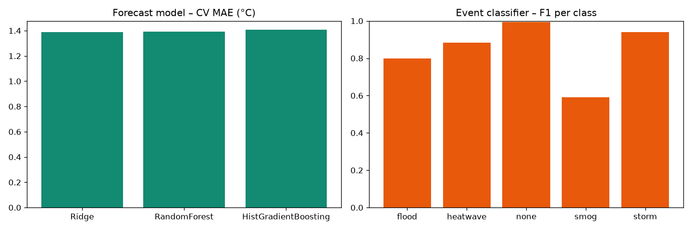

# Abstract

We present the machine-learning component of EarthScape, a big-data climate analytics platform. Using 39,456 daily readings from 12 stations across six climate zones (2016–2024) with 12 variables from weather stations, environmental sensors and satellite products, we train (i) a next-day temperature forecaster, (ii) a five-class extreme-event classifier, (iii) an anomaly detector and (iv) trend and seasonal models. Station-and-month climatology deviations and temporal lag features are central to performance. With strict time-based validation, the forecaster achieves MAE 1.35 °C (R² 0.94) on a hold-out period, beating persistence (1.71 °C); on an independent 2024 test year the event classifier attains macro-F1 0.91 and the anomaly detector precision 0.79 / recall 0.58. Models are retrained automatically and versioned at runtime.

# 1. Introduction

Climate services require forecasts, early identification of extreme events and quality control of observations. Classical statistical methods remain strong baselines, while tree ensembles handle non-linear interactions and missing data well. We focus on lightweight models that train in under a minute on a laptop, enabling continuous retraining inside an operational application.

# 2. Data

| Property  | Value                                                                                                                          |
|-----------|--------------------------------------------------------------------------------------------------------------------------------|
| Stations  | 12 (arid-coastal, arid, semi-arid, humid-subtropical, temperate, cold-arid, cold-desert)                                       |
| Training  | 2016–2023, 35,064 readings                                                                                                     |
| Test      | 2024, 4,392 readings                                                                                                           |
| Variables | temperature (mean/max/min), humidity, precipitation, wind, pressure, CO₂, PM2.5, NDVI, land-surface temperature, soil moisture |
| Labels    | event_type (none 97.7%, heatwave 1.3%, smog 0.5%, flood 0.3%, storm 0.2%); is_anomaly                                          |
| Missing   | 2–6% in six variables                                                                                                          |

Data are simulated with physically motivated seasonality, monsoon, warming trend, regional climate and injected extremes and sensor faults.

# 3. Methods

## 3.1 Pre-processing

Type coercion, median imputation inside pipelines, forward-fill for lags, standard scaling, one-hot encoding of climate zone. Station metadata completed from a registry.

## 3.2 Feature engineering

- Seasonal encoding: sin/cos of day-of-year.
- Climatology deviation: z = (x − μ_station,month) / σ_station,month for temperature, precipitation, wind, PM2.5, humidity and pressure.
- Lag features: temperature at t, t−1, t−2, t−6 and a 7-day rolling mean.

## 3.3 Models

| Task                      | Candidates                                                                        | Selection                        |
|---------------------------|-----------------------------------------------------------------------------------|----------------------------------|
| Next-day temperature      | Ridge, Random Forest (120 trees, depth 14), HistGradientBoosting (250 iterations) | lowest TimeSeriesSplit MAE       |
| Extreme event (5 classes) | Random Forest (200 trees, balanced), HistGradientBoosting (balanced)              | highest TimeSeriesSplit macro-F1 |
| Anomaly                   | Isolation Forest (200 trees, contamination 0.03) on deviations, OR max            | z                                |
| Trend                     | OLS on annual means per station                                                   | –                                |
| Seasonal outlook          | OLS on time + 12-month harmonics per region                                       | –                                |

## 3.4 Validation

Four-fold TimeSeriesSplit on the training period for model selection, a chronological 15% hold-out, and an independent 2024 test year. No shuffling, to avoid temporal leakage.

## 3.5 Explainability

For an input reading, each variable is replaced by its station-month normal and the change in event probability is reported – a model-agnostic, counterfactual explanation that is easy for stakeholders to read.

# 4. Results

Model results

| Model                 | Metric             | Hold-out (2022–23) | 2024 test   |
|-----------------------|--------------------|--------------------|-------------|
| Forecast (Ridge)      | MAE °C             | 1.35               | 1.70        |
| Forecast              | R²                 | 0.94               | –           |
| Persistence baseline  | MAE °C             | 1.71               | –           |
| Event classifier (RF) | macro-F1           | 0.84               | 0.91        |
| Event classifier      | accuracy           | 0.99               | –           |
| Anomaly detector      | precision / recall | 0.26 / 0.42        | 0.79 / 0.58 |
| Trend                 | mean warming       | +0.41 °C/decade    | –           |

Cross-validated MAE was nearly identical for all three regressors (1.39–1.41 °C), so the simplest model, Ridge, was selected – a sign that lagged temperature and seasonality carry most of the signal. Per-class F1 on the hold-out: storm 0.94, heatwave 0.88, flood 0.80, smog 0.59. Smog is hardest because it overlaps with normal winter pollution in Punjab. Anomaly precision is lower on the short hold-out (winter-heavy) than on the full test year, where heatwave and flood spells dominate the anomalies.

# 5. Discussion

- Climatology deviations make one model work across very different climates.
- Persistence is a strong baseline for daily temperature; lag features give a 21% improvement.
- Class imbalance (≈2% events) is handled with balanced class weights and macro-F1 selection.
- Automatic retraining every 2,000 readings plus PSI drift monitoring keeps models current as the climate warms.

# 6. Limitations and Future Work

Simulated data; daily resolution; no spatial modelling. Next steps: gridded reanalysis data (ERA5), spatio-temporal deep learning (ConvLSTM, graph neural networks), probabilistic forecasts and SHAP explanations.

# 7. Conclusion

Simple, well-engineered models trained at runtime provide accurate, explainable and continuously updated climate predictions suitable for an operational early-warning platform.

# References

1.  Breiman, L. (2001). Random Forests. *Machine Learning*, 45(1), 5–32.
2.  Liu, F. T., Ting, K. M., & Zhou, Z.-H. (2008). Isolation Forest. *IEEE ICDM*.
3.  Friedman, J. H. (2001). Greedy function approximation: a gradient boosting machine. *Annals of Statistics*, 29(5).
4.  Ke, G. et al. (2017). LightGBM: A highly efficient gradient boosting decision tree. *NeurIPS*.
5.  Pedregosa, F. et al. (2011). Scikit-learn: Machine Learning in Python. *JMLR*, 12.
6.  Rasp, S. et al. (2020). WeatherBench: a benchmark data set for data-driven weather forecasting. *JAMES*, 12.
7.  Chandola, V., Banerjee, A., & Kumar, V. (2009). Anomaly detection: a survey. *ACM Computing Surveys*, 41(3).
